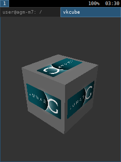
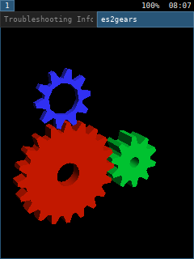
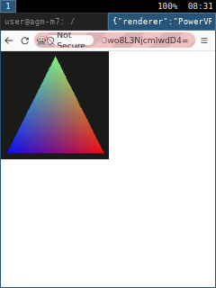

# GPU

## Hardware

- PowerVR Rogue GE8100 (Series 8XE), BVNC 22.49.21.16, MIPS firmware processor.
- Stock driver: DDK 1.9@4893595, OpenGL ES 3.2.
- Stock DT:
  - `mfg_auckland@13000000`, size 0x80000, SPI 226 level, 570 MHz.
  - Clocks: `CLK_TOP_MFG` (topckgen 45, `mfg_sel`), `CLK_TOP_MFG_OFF`, `CLK_TOP_MFG_ON` (topckgen 32).
  - Power: scpsys MFG0 and MFG1.
  - `mfg_cfg@13ffe000`: HW APM registers (0x24, 0x504..0x528), set by `MTKInitHWAPM`.
- Core config (`rgxconfig_km_22.V.21.16.h`): 1 cluster, 1 raster pipe, 2 ISP pipes, 40-bit GPU VA, 32-bit physical bus, SLC 8 KiB.

## Upstream status

- Kernel `drivers/gpu/drm/imagination` supports 33.15.11.3 and 36.53.104.796. 36.52.104.182 is experimental. Other cores need `exp_hw_support=1`.
- The kernel reads the feature list from the firmware file. Imagination publishes no `rogue_22.49.21.16_v1.fw`.
- Mesa `src/imagination` has GE8300 (22.67.54.30, 22.68.54.30, 22.102.54.38) as unsupported. GE8100 is not listed.

## Vendor firmware

- `/vendor/firmware/rgx.fw.signed` is a plain MIPS32 ELF with symbols and DWARF. There is no signature wrapper.
- Its firmware interface (FWIF) is DDK 1.9 and does not match mainline:

| Struct | DDK 1.9 | Mainline |
|---|---|---|
| init | 608 (`RGXFWIF_INIT`) | 544 sysinit + 104 osinit |
| kccb_cmd | 144 | 88 |
| ccb_ctl | 16 | 144 |
| ccb_cmd_header | 56 | 40 |
| fwcommoncontext | 160 | 152 |
| hwrtdata | 328 | 384 |
| tracebuf | 728 | 864 |
| runtime_cfg | 20 | 72 |
| compchecks_bvnc | 24 | 16 |
| fwmemcontext | 24 | 32 |
| freelist | 64 | 64 |

## Reference source

The matching DDK 1.9 kernel side, with MT6739 platform code, is public:
github.com/LgPWNd/Alcatel_mt6739_5059R_and_5041C_universal_kernel-4.4.95-,
`kernel-4.4.95/drivers/misc/mediatek/gpu/gpu_rgx/m1.9ED4893595/`.

- `services/system/rgx_mtk/mt6739/mtk_mfgsys.c`: power and clock sequence, HW APM.
- `hwdefs/km/cores/rgxcore_km_22.49.21.16.h`: BRNs 60084, 61450, 63027, 65273, 63553.

## Stage 1 (done)

- MFG0 (`MFG_PWR_CON` 0x338, status bit 4, bus protect bits 21 and 22) and MFG1 (`MFG_CORE0_PWR_CON` 0x33c, status bit 31) in `mt6739-pm-domains.h`. MFG1 is a subdomain of MFG0.
- `gpu@13000000` uses `mfg_sel` as its core clock. LK leaves MFGPLL at 570 MHz and Vcore at 1.15 V.
- `insmod powervr.ko exp_hw_support=1` reads BVNC 22.49.21.16, then fails on the missing `powervr/rogue_22.49.21.16_v1.fw`.
- genpd keeps all domains of a provider on until every consumer has probed. The GPU never probes yet, so CONN stayed on and the CONSYS ROM hung at PC 0x98d4. CONN now has `MTK_SCPD_NO_STAY_ON`.
- The vendor MFG sequence also changes `INFRA_TOPAXI_SI0_CTL` (0x10001200; bit 7 way_en, bit 1 bypass) around the bus protect. The mainline driver does not do that yet.

## Stage 2 (done)

- DT compatible `mediatek,mt6739-gpu` selects the DDK 1.9 path (`pvr_ddk19.c`). The rest of the driver is unchanged.
- Firmware: `rgx.fw.signed` from the stock vendor partition, now in the private repo `itsvic-dev/agm-m7-firmware`. `nixos/vendor.nix` installs it as `powervr/rogue_22.49.21.16_ddk19.fw`.
- The driver synthesises the layout table and the feature set (from `rgxconfig_km_22.V.21.16.h`) instead of reading a mainline firmware trailer.
- MIPS: 32 MiB heap at 0xC0000000, one 32 KiB contiguous page table, boot data (regs, page table, stack, `RGXFWIF_INIT`) in the boot/NMI data page, wrapper config with the physical register bank address, no trampoline.
- `pvr_ddk19_fwif.h` has the 1.9 structs. Offsets come from the firmware DWARF (`tools/fwif-dwarf.py`) and are checked with `static_assert`.
- HW APM writes to `mfg_cfg` after every power-on, as `MTKInitHWAPM` does.
- Result: `firmware_started` is set, compatibility checks report BVNC 22.49.21.16, DDK 1.9 build 4893595, MIPS. The firmware trace works (decode with `rgx_fwif_sf.h`: id = bits 0-11, group = bits 12-15, argument count = bits 16-19).
- The probe then stops on purpose with `-ENODEV` and halts the firmware.

## Stage 3a (done)

- The firmware keeps running after probe. `fw_dev.initialised` is set, the DRM device registers.
- Kernel CCB: 128 commands of 144 bytes, MTS kick on DM GP. Completion through sync words (`SYNC` command), no return slots.
- Firmware CCB: processed in the IRQ thread. Commands are only logged for now.
- Runtime PM: `FORCED_IDLE_REQ`, then `OFF_REQ` (forced), then `pvr_fw_stop()`, then MFG power off. Resume restarts the firmware and waits for `firmware_started`. A forced power off without forced idle first makes the firmware assert (`rgxfw_irq.c:693`).
- MMU cache flush uses `MMUCACHE` with the mainline flag values (they match 1.9).
- Job ioctls (VM and job contexts, free lists, HWRT datasets, submit) return `-EOPNOTSUPP`.
- Debugfs `dri/13000000.gpu/ddk19/`: `state` (power state, CCB offsets, assert, trace) and `sync` (write to send a `SYNC`). Decode the trace with `tools/fwtrace-decode.py rgx_fwif_sf.h < state`.

## Stage 3b (done)

- The first 24 bytes of the mainline FW memory context match `RGXFWIF_FWMEMCONTEXT`, so the mainline VM code works unchanged. The MMU definitions of both are the same.
- `tools/pvr-vmtest.c`: VM context, BO, map, unmap. Map and unmap send `MMUCACHE` through the firmware.

## Stage 3c (compute, kernel side done)

- Client CCB: 56-byte headers, 1.9 command types (task bit 31, no magic). Size estimates use the larger header.
- `KICK` carries the context's DM (CDM = 4). With DM 0 the firmware queues the work on GP and nothing runs.
- Compute context: 160-byte `RGXFWIF_FWCOMMONCONTEXT`, then the mainline static compute state for our own use. The context state object holds the 8-byte `COMPUTECTX_STATE` and a 16-byte RF command. The firmware dereferences the RF command pointer once BRN 65273 is set up, so it must not be 0.
- BRN 65273: before the first compute kick after power-up, `rgxfw_framework_kick_cdm` loads the context PC into all 8 BIF catalogue bases and runs dummy tiling passes into `0xF800000000` (INIA) and `0xF900000000` (INIB). Every VM context maps 64 KiB there. The vendor userspace does the same ("BRN65273_RgnHeader").
- MFG1 (dusts): HW APM switches it through the SPM firmware, which mainline does not load. MFG1 is a normal genpd domain under the GPU, off by default; HW APM is off (`powervr.hw_apm`).
- `tools/pvr-computetest.c`: a compute job whose control stream is only `STREAM_TERMINATE` (0x80000000). Runs without HWR.
- Not done: `PDS_CTRL`, `TPU`, `TPU_ARRAYS_CDM`, `COMPUTE_THREAD_BARRIER` and the YUV coefficients are 0 in the compute command. Mesa does not send them. Read the vendor values on LineageOS before running real shaders.
- Heaps: with BRN 65273 the PDS, USC and VisTest heaps must sit in one 1 GiB PC entry each (1.9: PDS 0xA800000000, USC 0xBA00000000). The kernel still reports the mainline heaps.
- Debugging: `ddk19/state` lists HWR entries (type, DM, BIF/MMU status, PC address); `ddk19/nmi` takes an NMI and prints the MIPS EPC, cause and bad address. Disassemble with `mipsel-linux-gnu-objdump -d -l -M micromips`; the firmware has symbols and line info.

## Stage 4 (Mesa, started)

- `nixos/gpu.nix`: Mesa overlay with only the `imagination` Vulkan driver (no OpenGL, EGL, GBM or LLVM; about 13 MiB) and `vulkan-tools`. Sway stays on pixman.
- Mesa comes from the fork github.com/itsvic-dev/mesa: branch `agm-m7` (upstream 26.2.3 plus the GE8100 commits) for NixOS, `agm-m7-android` (LineageOS `lineage-24.0` plus the same commits plus the Android ones) for `external/mesa`. The device entry for 22.49.21.16 uses the GE8300 features for now.
- Kernel: free lists (1.9 adds a HWR counter at offset 40), render contexts (TA and 3D common contexts back to back, 328 bytes) and transfer contexts (one 3D common context). Each queue state object is followed by its RF command.
- `PVR_I_WANT_A_BROKEN_VULKAN_DRIVER=1 vulkaninfo` lists "PowerVR Rogue GE8100", Vulkan 1.2. Device creation runs about 56 firmware commands without HWR.
- Fixed: MMU flush, cleanup and `SYNC` must hold a runtime PM reference. Without it the firmware read one slot past the KCCB write offset and later kicks failed, so `vulkaninfo` hung.

## Compute (done)

- `tools/vk-compute` (installed as `vk-compute [groups]`): GLSL compute shader, each invocation writes `i * 3 + 1`, checked on the CPU. Passes up to 16384 groups (1M invocations) without HWR.
- The 1.9 CDM kick writes the command fields to registers: control stream base 0x480, border colour table 0x17A8, thread barrier 0x708, `PDS_CTRL` 0x600 (only bits 24-31, the CDM task limit), `TPU` 0x1780, context switch 0x498 to 0x4C0. With a task limit of 0 no CDM task runs; the kernel sets 48.
- Heaps: with BRN 65273 the firmware runs PDS and USC code relative to 0xA800000000 and 0xBA00000000, so the kernel reports the 1.9 heap layout (general 0x65C0000000, 2 GiB; transfer from 2 MiB, inside the first 1 GiB).
- Still 0: `TPU`, `TPU_ARRAYS_CDM`, `COMPUTE_THREAD_BARRIER`, YUV coefficients. Not needed for this test.

## Render (done)

- `tools/vk-triangle` (installed as `vk-triangle`): render pass with a clear and a red triangle into a twiddled RGBA8 image, read back with a compute shader. `WIDTH`, `HEIGHT`, `RAW=1` (map the image memory and print it de-twiddled on the CPU), `clear` (no draw), `store` (compute store and readback only).
- Kernel: 1.9 HWRT data (328 bytes), `RENDER_TARGET` and `RTA_CTL` objects; HWRT cleanup on the TA DM, then the 3D DM. TA (280 bytes) and 3D (664 bytes) commands are built from the mainline commands, the HWRT data and the static render state. The combined geometry and fragment kick does not exist in 1.9: the kernel sends a TA kick, then a 3D kick, each with the HWRT cleanup state.
- The firmware detects the first TA kick from the HWRT state, not from the first-kick flag. All TE, PPP and ISP merge values in the HWRT go to registers unchanged. The firmware register use for TA, 3D and PM setup is in `docs/GPU-render-map.md`.
- Mesa needs `max_partitions`, `usc_min_output_registers_per_pix` and `common_store_size_in_dwords` from the kernel. Without them it enables no USC partitions and the 3D job hangs (HWR on DM 3).
- Simple parameter format 1: Mesa and mainline only handled the 2x2 tile groups of format 2. Both now use one macrotile over the whole render.
- `tools/vk-triangle` modes: `DEPTH=1|2|3` (D16 clear 1.0, D16 clear 0.0, D32), `UBO=1` and `Z=` (positions from a uniform buffer), `TEX=1|2` (texture from a render pass or a buffer copy), `VARY=1`, `DERIV=1`, `PROBE=n` (pieces of the vkcube fragment shader), `TILE=x,y` (draw into one tile) and `PAUSE=s`. Every mode also passes on MoltenVK as a reference.
- Region headers on this core: 5 bytes per 16x16 tile. First byte: 0x01 empty, 0x10 has a control stream, 0x04 last header (the ISP stops there). Bytes 1-2: control stream offset in 32-byte units.
- Fixes found on the way:
  - The terminate PPP state clips the render in 16-pixel units on the GE8100, not in 32-pixel blocks as `ppp.xml` says. With 32, only the top-left quarter was drawn.
  - The ISP compares depth as floats: the D16 background depth must be a float, not UNORM16.
  - The GE8100 has no `usc_itrsmp_enhanced` (DITR). With it, interpolated varyings were garbage.
  - The firmware's one-time dummy region header init writes 5 KiB; it now goes to the INIA scratch buffer.
  - Transfer jobs are translated; `ISP_PIXEL_BASE` is the transfer heap base (0).
- Display: Sway renders with pixman, so Vulkan presents through `wl_shm` from a linear image (`MESA_VK_WSI_DEBUG=sw,linear`, set system-wide).
- vkcube runs: `vkcube --wsi wayland` in the Sway session. No HWR.
- udev loads the driver at boot. The firmware is in the Nix store, so no mount is needed first.

- Screenshots: `scripts/screenshot.sh [file]`.

## OpenGL through Zink

- Mesa builds Zink, EGL, GBM and glvnd (`draw-use-llvm` off, so no LLVM at runtime). `MESA_LOADER_DRIVER_OVERRIDE=zink` is set system-wide.
- Sway with pixman advertises no DRM device, so EGL has no render node. `nixos/patches/mesa-zink-shm.patch` keeps Zink on the `wl_shm` fallback and binds the EGL display to the first render node. Without the second part, Firefox sees a software EGL device and blocks acceleration.
- Zink gives GL 2.1 and GLES 2.0: the driver has no transform feedback, which GL 3.0 and GLES 3.0 need. Other missing Zink features: `fillModeNonSolid`, `customBorderColorWithoutFormat`, most line modes.
- D24 and D24S8 need a float depth clear too, like D16.
- es2gears runs at about 9 FPS:

- Firefox: WebGL 1 runs on the GPU. WebGL 2 needs GLES 3. WebRender stays in software (`gfx.webrender.software` in `nixos/firefox.nix`; gfxInfo also blocks it below GL 3).
- With `MESA_GLES_VERSION_OVERRIDE=3.0` and the software pref removed, hardware WebRender starts, then locks the GPU (FWCCB 105 context reset, 104 free list reconstruction).
- WebGPU (`dom.webgpu.enabled`): `requestAdapter()` returns null. Not investigated.

## HWR (done)

- The kernel answers FWCCB 103 (free list grow) and 104 (free list reconstruction), and logs 105 (context reset). The 1.9 host increments the free list `hwr_counter` and does not reset the HWRT state. The reconstruction reply goes on the TA DM, the grow reply on the 3D DM.
- With `ui32MaxDeadlineMS` 0 the firmware uses its default deadline: a hung fragment shader is reset after about 20 s (reason 3, guilty overrunning). If the process exits first, the firmware sees page faults instead.
- After recovery, compute and render jobs run again.

## Storage images (done)

- Without `tpu_extended_integer_lookup`, Mesa set `index_lookup` in every storage image descriptor but still sent float coordinates. The TPU read 1.0 as index 0x3f800000, so only texel (0,0) worked: other loads returned 0 and other stores were lost. The fork no longer sets the bit.
- `tools/vk-image` (installed as `vk-image load|store`, `WIDTH`, `HEIGHT`): R32UI image, the CPU writes or finds each texel at its twiddled offset.
- All `vk-triangle` modes pass the readback. `TILE` and `PROBE` fail the built-in centre check by design.

## Pixel centre (done)

- On the GE8100, `pixel` and `centroid` iteration and the `SR_X_P`/`SR_Y_P` registers give the pixel corner, so `gl_FragCoord` was an integer and varyings were half a pixel off. Text and anti-aliased edges in the Android UI broke. `sample` iteration and `SR_X_S`/`SR_Y_S` give the centre; Mesa uses them on cores without `usc_itrsmp_enhanced`.
- `ISP_CTL.ISP_SAMPLE_POS_MODE` (DX10, OGL) does not fix it: with either value, render jobs write nothing.
- `tools/vk-raster` (installed as `vk-raster`): checks `gl_FragCoord`, varyings and nearest texture lookups per pixel. MoltenVK passes it as a reference.

## Macrotile array (done)

- On Android, TA and 3D jobs faulted about every 6 s: the PM wrote its macrotile array (`PMA_MAVP`, BIF tag 0xA, sideband 6) to address 0. With the simple internal parameter format, Mesa allocated no macrotile array, but the GE8100 PM still writes it. The fork now gives each HWRT data a 4 KiB array; no resets since.

## Mesa CPU overhead (done)

- `simpleperf` on the HWUI render thread: about a third was the kernel creating, mapping and freeing GEM objects, and every render pass compiled its end-of-tile shader.
- The fork keeps freed CPU mapped buffers mapped for reuse (at most 4 MiB per process) and caches end-of-tile programs per device.

## Android

- GLES through ANGLE on the PowerVR Vulkan driver; HWUI and SurfaceFlinger render with Vulkan directly. Apps are compiled at build time (`speed`).
- `scripts/android-ui-bench.sh` drives quick settings, the app drawer, Settings and the wallpaper picker, then prints `gfxinfo` frame times.

| App | Before (ANGLE) | After (Vulkan, caches) |
|---|---|---|
| Launcher | 40 ms median, 63% janky | 15 ms, 6% |
| Settings | 24 ms, 16% | 14 ms, 6% |
| SystemUI | 48 ms, 62% | 29 ms, 35% |

- Screen off: `drm_hwcomposer` disabled the CRTC while its plane still had a framebuffer; the fork github.com/itsvic-dev/drm_hwcomposer (branch `agm-m7`) disables the planes in the same commit.

## Open

- Android: the low memory killer kills the wallpaper picker (about 220 MB, 155 MB native heap) on the Vulkan build; it survived on the ANGLE build. With Vulkan the picker itself is smaller, so the extra pressure comes from other processes. Not measured yet.
- Device features copied from the GE8300 and not verified: the vendor uses `max_partitions` 6 and `isp_max_tiles_in_flight` 2 (we have 10 and 4). USC store sizes and TPU and UVS values are unknown; `libusc.so` in `/vendor/lib` may have them.

## Plan

1. Platform: MFG power domains, clocks and DT node. Read the core ID register. Done.
2. Firmware boot: repack the ELF for the mainline loader, add a DDK 1.9 init path, pass the compatibility check. Done.
3. Jobs: DDK 1.9 command queues, geometry and 3D commands, render targets.
4. Mesa: GE8100 device info, vkcube, then Zink.
